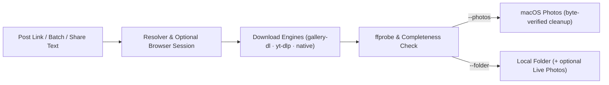

# linkget

Save photos and videos from a post link to **macOS Photos** or a local folder.
A local-first macOS CLI (`MIT` · current stable release `v0.3.0`) with browser session reuse, completeness checks, and no hosted service.



## Install

Requires macOS and [Homebrew](https://brew.sh/) (installs Python, `gallery-dl`, `yt-dlp`, `ffmpeg`, and `deno`):

```sh
brew install Popcornnnnnnnn/tap/linkget
linkget
```

See [docs/INSTALL.md](docs/INSTALL.md) for wheel installation, upgrades, and uninstall instructions.

## Quick Start

```sh
linkget                                              # interactive prompt (defaults to Photos)
linkget 'https://www.bilibili.com/video/BV1bK411W797/' --folder ~/Downloads
linkget --photos --live-photos                       # package picture + motion pairs
linkget batch                                        # paste one URL per line, blank line to start
linkget retry                                        # retry unfinished items from latest task
linkget read 'URL' --folder ./notes                  # extract subtitles, speech & text in background
```

> Always wrap URLs in straight ASCII quotes (`'...'` or `"..."`) so the shell does not split `&` or `?`.

## Core Commands

| Command | Purpose |
| --- | --- |
| `linkget help` / `linkget COMMAND --help` | Show usage or subcommand options |
| `linkget sites` / `linkget doctor` | List supported sites or inspect local tools & sessions |
| `linkget config [--photos \| --folder [PATH]]` | Show or change the default destination & reader browser |
| `linkget batch [URL ...]` | Download multiple posts concurrently (`--jobs N`) |
| `linkget tasks [TASK]` | Inspect download and background read task states |
| `linkget retry [TASK]` / `linkget recover [TASK]` | Resume failed tasks or save verified staged media |
| `linkget read URL --folder DIR` | Extract text/subtitles/ASR, `summarize`, or `translate` ([docs/READ.md](docs/READ.md)) |
| `linkget auth [SITE]` / `linkget logout [SITE\|all]` | Inspect, connect, or disconnect optional site logins |

## Supported Sites (Single Posts)

| Site | Supported Media | Notes |
| --- | --- | --- |
| Instagram | Photos, videos, Reels | — |
| X / Twitter | Photos, videos | — |
| Bilibili | Video (`BV`/`av`) & Opus | Login exposes higher quality; one part per URL |
| TikTok | Photo posts, videos | Supports share links |
| Douyin | Photo posts, videos | Clean playback ranking; optional BrowserOS neo / Chrome fallback |
| Xiaohongshu *(trial)* | Image sets, videos | Keep full link including `xsec_token` |
| Weibo | Photos, videos | Heuristic watermark-free JPEG selection ([audit](docs/WEIBO_IMAGE_AUDIT.md)) |
| YouTube | Single videos, Shorts | Playlist-only URLs and streams excluded |
| Reddit *(trial)* | Photos, galleries, videos | Via `gallery-dl` |
| Kuaishou *(trial)* | `/short-video/` videos | HEVC preferred at equal resolution |
| LOFTER *(trial)* | Photos, videos | Via `gallery-dl` |
| Pixiv *(trial)* | Static artworks | Ugoira and collections excluded |
| Pinterest *(trial)* | Pins, boards | Via `gallery-dl` |

## Privacy & Development

- **Local only:** Zero telemetry. Saved sessions and job receipts stay local with user-only permissions; `--browser none` disables all browser reads.
- **Verified imports:** Photos mode verifies managed library copies byte-for-byte before deleting staged downloads (`~/Library/Application Support/linkget/`).

```sh
PYTHONPATH=src python3 -m unittest discover -s tests -q
uv build
```

## Documentation

- [Detailed Usage & Reference](docs/USAGE_REFERENCE.md) — batch panel rules, recovery, `--report`, `--live-photos`, browser auth, and site heuristics
- [Installation](docs/INSTALL.md) · [Reading Mode](docs/READ.md) · [Testing Scope](docs/TESTING.md) · [Reliability](docs/RELIABILITY.md) · [Media Validation](docs/MEDIA_VALIDATION.md)
- Bugs & support: [GitHub Issues](https://github.com/Popcornnnnnnnn/linkget/issues) (include `linkget --version` and `linkget doctor`; never attach cookies)
