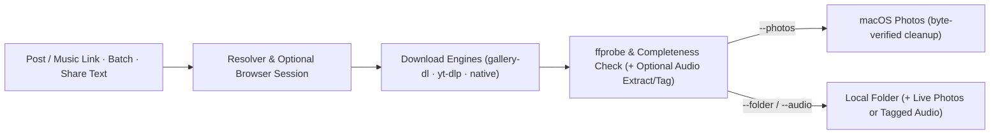

# linkget

**English** · [简体中文](README.zh-CN.md)

**Website:** [linkget.popcornnn.xyz](https://linkget.popcornnn.xyz) · **Community:** [LINUX DO](https://linux.do/)

[](https://linux.do/)

Save photos, videos, and audio from a post or music link to **macOS Photos** or a local folder.
A local-first macOS CLI (`MIT` · current stable release `v0.4.0`) with browser session reuse, completeness checks, and no hosted service.



## Install

Requires macOS and [Homebrew](https://brew.sh/) (installs Python, `gallery-dl`, `yt-dlp`, `ffmpeg`, and `deno`):

```sh
brew install Popcornnnnnnnn/tap/linkget
linkget
```

See [docs/INSTALL.md](docs/INSTALL.md) for wheel installation, upgrades, and uninstall instructions.

## Quick Start

```sh
linkget                                              # interactive prompt (defaults to Photos)
linkget 'https://www.bilibili.com/video/BV1bK411W797/' --folder ~/Downloads
linkget 'PHOTO_URL' --as photo --photos              # save still images to Apple Photos
linkget 'VIDEO_URL' --as video --folder ~/Downloads  # save a single video with yt-dlp
linkget 'https://www.youtube.com/watch?v=dQw4w9WgXcQ' --audio --folder ~/Music
linkget 'https://soundcloud.com/artist/track'        # music links download audio automatically
linkget 'https://x.com/USER/status/ID' --folder ~/Articles   # auto-archives X Articles offline
linkget 'https://x.com/USER/article/ID' --photos             # render X Article as PNG into Apple Photos
linkget 'https://example.com/post' --as article --folder ~/Articles
linkget --photos --live-photos                       # package picture + motion pairs
linkget batch                                        # paste one URL per line, blank line to start
linkget retry                                        # retry unfinished items from latest task
linkget read 'URL' --folder ./notes                  # extract subtitles, speech & text in background
```

> Always wrap URLs in straight ASCII quotes (`'...'` or `"..."`) so the shell does not split `&` or `?`.

The development build detects what to save by default. Use `--as photo`, `--as video`, or `--as article` to choose the output. Set the destination separately with `--photos` for Apple Photos or `--folder PATH` for a local folder. Articles use a folder by default (Obsidian-ready `article.md` via `linkget config --article-folder ~/path/to/Vault/Clippings`), and X Articles can also be rendered as high-resolution PNGs into Apple Photos (`--photos` or `linkget config --x-article-photos`). Both `--video` and `--article` still work as shortcuts.

Video mode can try sites beyond the list below. Availability depends on your installed yt-dlp and the MP4 formats the site offers.

## Demos

**Save a video clip to a local folder.** This demo uses [Blender’s Big Buck Bunny](https://vimeo.com/1084537) and the development build.


**Archive a web page for offline reading.** The saved folder contains HTML, Markdown, and plain text.


## Core Commands

| Command | Purpose |
| --- | --- |
| `linkget help` / `linkget COMMAND --help` | Show usage or subcommand options |
| `linkget sites` / `linkget doctor` | List supported sites or inspect local tools & sessions |
| `linkget inspect URL` | Inspect routing, metadata, tools, and session state without downloading |
| `linkget config [--photos \| --folder [PATH] \| --audio-folder [PATH] \| --article-folder [PATH] \| --x-article-photos]` | Show or change defaults for media, audio, articles, X Article Photos, and reader browser |
| `linkget batch [URL ...]` | Download multiple posts or articles concurrently (`--jobs N`) |
| `linkget tasks [TASK]` | Inspect download and background read task states |
| `linkget retry [TASK]` / `linkget recover [TASK]` | Resume failed tasks or save verified staged media |
| `linkget clean [--apply] [--older-than 7d]` | Preview or remove old completed temporary staging folders |
| `linkget mcp` | Run a stdlib JSON-RPC 2.0 stdio MCP server (`inspect_url`, `download_media`, `batch_download`, `read_content`, `get_task`, `retry_task`, `clean_stages`, `doctor`) |
| `linkget read URL --folder DIR` | Extract text/subtitles/ASR/keyframes, web & WeChat articles, `wait`, `show`, `summarize`, or `translate` ([docs/READ.md](docs/READ.md)) |
| `linkget auth [SITE]` / `linkget logout [SITE\|all]` | Inspect, connect, or disconnect optional site logins |
| `linkget upgrade [--check]` | Check for updates and upgrade linkget |

> Automation / AI agents: pass `--non-interactive --json` (or `--stdout` on `read`). See [Agent Skill](docs/AGENT_SKILL.md).

## Supported Sites (Single Posts)

| Site | Supported Media | Notes |
| --- | --- | --- |
| Instagram | Photos, videos, Reels | — |
| X / Twitter | Photos, videos, **X Articles** | Auto-detects Articles on `/status/ID` & `/article/ID` (`--folder` / `--article-folder` writes `article.md`, `article.html`, `content.json`, local `assets/`; `--photos` or `config --x-article-photos` renders a high-res PNG to Apple Photos) |
| WeChat / Toutiao / Zhihu / Web *(articles)* | Offline articles (`article.md`, `article.html`, assets) | Auto-enabled on WeChat/Toutiao/Zhihu/public web articles (`--article` forces X `/status/ID` checks; `--no-assets` skips media) |
| Bilibili | Video (`BV`/`av`), Opus, Audio (`au`) | Login exposes higher quality; one part or track per URL |
| TikTok | Photo posts, videos | Supports share links |
| Douyin | Photo posts, videos | Clean playback ranking; optional BrowserOS neo / Chrome fallback |
| Xiaohongshu *(trial)* | Image sets, videos | Keep full link including `xsec_token` |
| Weibo | Photos, videos | Heuristic watermark-free JPEG selection ([audit](docs/WEIBO_IMAGE_AUDIT.md)) |
| YouTube / YouTube Music | Single videos, Shorts, Music tracks | Playlist-only URLs and streams excluded; `music.youtube.com` auto-audio |
| Vimeo (development) | Single publicly embeddable videos | Accepts `vimeo.com/ID` and `player.vimeo.com/video/ID` |
| Dailymotion (development) | Single videos | Accepts `dailymotion.com/video/ID` and `dai.ly/ID` |
| Pornhub (development, trial) | Single videos | Accepts `view_video.php?viewkey=ID` and `/embed/ID`; availability depends on yt-dlp and regional access. Account sign-in is unavailable. |
| SoundCloud | Single tracks | Public tracks and `on.soundcloud.com` shares; sets excluded |
| Bandcamp | Single tracks | Public `/track/` links; albums excluded |
| Reddit *(trial)* | Photos, galleries, videos | Via `gallery-dl` |
| Kuaishou *(trial)* | `/short-video/` videos | HEVC preferred at equal resolution |
| LOFTER *(trial)* | Photos, videos | Via `gallery-dl` |
| Pixiv *(trial)* | Static artworks | Ugoira and collections excluded |
| Pinterest *(trial)* | Pins, boards | Via `gallery-dl` |

## Privacy & Development

- **Local only:** Zero telemetry. Saved sessions and job receipts stay local with user-only permissions; `--browser none` disables all browser reads.
- **Verified imports:** Photos mode verifies managed library copies byte-for-byte before deleting staged downloads (`~/Library/Application Support/linkget/`).

```sh
PYTHONPATH=src python3 -m unittest discover -s tests -q
uv build
```

## Raycast Extension

Use the bundled [Raycast Extension](raycast/README.md) (`raycast/`) for a focused two-command macOS launcher UI over `linkget` (**Apple Photos** by default for pics/videos, **`~/Downloads`** for articles):

- **Save Link (`lg`)** — Paste one or more links, review what will be saved and where, and override the detected type or destination when needed (including multi-link batch paste and X Article → Apple Photos). Save in the foreground or track a background save in Status Board.
- **Status Board (`lgs`)** — Unified board for recent downloads & saved articles (cover & Markdown preview, inline reader, Copy Article Markdown, open `article.html`, retry failures) plus CLI defaults, engines, site sessions, and `linkget clean`.

## Documentation

- [Detailed Usage & Reference](docs/USAGE_REFERENCE.md) — batch panel rules, recovery, `--report`, `--live-photos`, browser auth, and site heuristics
- [Installation](docs/INSTALL.md) · [Reading Mode](docs/READ.md) · [Agent Skill](docs/AGENT_SKILL.md) · [Testing Scope](docs/TESTING.md) · [Reliability](docs/RELIABILITY.md) · [Media Validation](docs/MEDIA_VALIDATION.md)
- Bugs & support: [GitHub Issues](https://github.com/Popcornnnnnnnn/linkget/issues) (include `linkget --version` and `linkget doctor`; never attach cookies)
