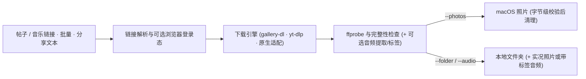

# linkget

[English](README.md) · **简体中文**

将帖子或音乐链接中的图片、视频与音频保存到 **macOS 照片**或本地文件夹。
一个本地优先的 macOS CLI（`MIT` · 当前稳定版本 `v0.3.2`），支持复用浏览器登录态、完整性校验且无需任何托管服务。



## 安装

需要 macOS 与 [Homebrew](https://brew.sh/)（会自动安装 Python、`gallery-dl`、`yt-dlp`、`ffmpeg` 与 `deno`）：

```sh
brew install Popcornnnnnnnn/tap/linkget
linkget
```

关于 wheel 安装、升级与卸载说明，请参阅 [docs/INSTALL.md](docs/INSTALL.md)。

## 快速开始

```sh
linkget                                              # 交互式输入（默认保存至照片）
linkget 'https://www.bilibili.com/video/BV1bK411W797/' --folder ~/Downloads
linkget 'https://www.youtube.com/watch?v=dQw4w9WgXcQ' --audio --folder ~/Music
linkget 'https://soundcloud.com/artist/track'        # 音乐链接会自动下载音频
linkget 'https://x.com/USER/status/ID' --folder ~/Articles   # 自动离线归档 X Articles
linkget 'https://example.com/post' --article --folder ~/Articles  # 保存网页文章与本地资源
linkget --photos --live-photos                       # 封装静态图 + 动态视频为实况照片
linkget batch                                        # 每行粘贴一个链接，空行开始下载
linkget retry                                        # 重试最近一次任务中未完成的条目
linkget read 'URL' --folder ./notes                  # 在后台提取字幕、语音转录与正文文本
```

> 请始终使用直立 ASCII 引号（`'...'` 或 `"..."`）包裹 URL，避免 Shell 解析 `&` 或 `?`。

## 操作演示

**将视频片段保存到本地文件夹。** 此演示使用开发版，示例视频为 [Blender 的《Big Buck Bunny》](https://vimeo.com/1084537)。


**将网页归档以供离线阅读。** 保存的文件夹包含 HTML、Markdown 和纯文本。


## 核心命令

| 命令 | 用途 |
| --- | --- |
| `linkget help` / `linkget COMMAND --help` | 查看总览用法或子命令选项 |
| `linkget sites` / `linkget doctor` | 列出支持的站点，或检查本地工具与登录态 |
| `linkget inspect URL` | 不执行下载，仅检查路由、元数据、工具与登录态 |
| `linkget config [--photos \| --folder [PATH] \| --audio-folder [PATH] \| --article-folder [PATH]]` | 查看或修改媒体、音频、文章及阅读器浏览器的默认配置 |
| `linkget batch [URL ...]` | 并发下载多个帖子或文章（`--jobs N`） |
| `linkget tasks [TASK]` | 查看下载与后台阅读任务状态 |
| `linkget retry [TASK]` / `linkget recover [TASK]` | 恢复失败任务或保存已校验的暂存媒体 |
| `linkget clean [--apply] [--older-than 7d]` | 预览或清理旧的已完成临时暂存目录 |
| `linkget mcp` | 运行基于标准库的 JSON-RPC 2.0 stdio MCP 服务器（`inspect_url`、`download_media`、`read_content`、`get_task`、`doctor`） |
| `linkget read URL --folder DIR` | 提取正文/字幕/语音识别/关键帧、网页与微信文章，支持 `wait`、`show`、`summarize` 或 `translate`（[docs/READ.md](docs/READ.md)） |
| `linkget auth [SITE]` / `linkget logout [SITE\|all]` | 查看、连接或断开可选站点登录 |
| `linkget upgrade [--check]` | 检查更新并升级 linkget |

> 自动化 / AI 智能体调用：请传入 `--non-interactive --json`（或在 `read` 中使用 `--stdout`）。详见 [智能体技能说明](docs/AGENT_SKILL.md)。

## 支持站点（单条帖子）

| 站点 | 支持媒体 | 说明 |
| --- | --- | --- |
| Instagram | 图片、视频、Reels | — |
| X / Twitter | 图片、视频、**X Articles** | 自动识别 `/status/ID` 与 `/article/ID` 文章（`--folder` / `--article-folder` 会写入 `article.md`、`article.html`、`content.json` 及本地 `assets/`） |
| 微信 / 头条 / 知乎 / 网页*（文章）* | 离线文章（`article.md`、`article.html`、资源文件） | 微信/头条/知乎/公开网页文章默认自动开启（`--article` 强制检查 X `/status/ID`；`--no-assets` 跳过媒体下载） |
| Bilibili | 视频（`BV`/`av`）、图文 Opus、音频（`au`） | 登录后可获取更高画质；每次仅下载单个分 P 或单曲 |
| TikTok | 图文帖、视频 | 支持分享短链 |
| 抖音 | 图文帖、视频 | 优先无水印播放源；可选 BrowserOS neo / Chrome 回退 |
| 小红书 *（试用）* | 图集、视频 | 请保留包含 `xsec_token` 的完整链接 |
| 微博 | 图片、视频 | 启发式无水印 JPEG 优选（[审计报告](docs/WEIBO_IMAGE_AUDIT.md)） |
| YouTube / YouTube Music | 单个视频、Shorts、音乐单曲 | 不支持纯播放列表链接与直播流；`music.youtube.com` 自动提取音频 |
| Vimeo（开发版） | 单个可公开嵌入的视频 | 支持 `vimeo.com/ID` 和 `player.vimeo.com/video/ID` |
| Dailymotion（开发版） | 单个视频 | 支持 `dailymotion.com/video/ID` 和 `dai.ly/ID` |
| Pornhub（开发版，试用） | 单个视频 | 支持 `view_video.php?viewkey=ID` 和 `/embed/ID`；可用性取决于 yt-dlp 和所在地区，暂不支持账号登录 |
| SoundCloud | 单曲 | 支持公开单曲与 `on.soundcloud.com` 分享链接；不支持合集 |
| Bandcamp | 单曲 | 支持公开 `/track/` 链接；不支持整张专辑 |
| Reddit *（试用）* | 图片、图集、视频 | 通过 `gallery-dl` 支持 |
| 快手 *（试用）* | `/short-video/` 视频 | 同分辨率下优先 HEVC |
| LOFTER *（试用）* | 图片、视频 | 通过 `gallery-dl` 支持 |
| Pixiv *（试用）* | 静态插画作品 | 不支持动图（Ugoira）与画集 |
| Pinterest *（试用）* | Pin 与画板 | 通过 `gallery-dl` 支持 |

## 隐私与开发

- **仅在本地运行：** 零遥测。保存的会话与任务回执仅保存在本地且采用仅当前用户可读权限；`--browser none` 会禁用所有浏览器读取。
- **校验后入库：** 照片模式会在删除暂存下载文件（`~/Library/Application Support/linkget/`）前，逐字节校验照片图库中的托管原件副本。

```sh
PYTHONPATH=src python3 -m unittest discover -s tests -q
uv build
```

## Raycast 扩展

可使用仓库内置的 [Raycast 扩展](raycast/README.md)（`raycast/`），通过专注的双命令 macOS 启动器界面操作 `linkget`（图片/视频默认存入 **Apple 照片**，文章默认存入 **`~/Downloads`**）：

- **Save Link (`lg`)** — 粘贴链接（或抓取剪贴板 / 当前浏览器标签页），检查能力、选择模式、目标位置、片段/画质上限、音频格式或浏览器会话，并查看已保存文件。
- **Status Board (`lgs`)** — 统一看板，查看近期下载与已保存文章（封面与 Markdown 预览、行内阅读器、打开 `article.html`、重试失败项），以及 CLI 默认设置、引擎、站点登录态和 `linkget clean`。

## 文档索引

- [详细用法与参考](docs/USAGE_REFERENCE.md) — 批量面板规则、任务恢复、`--report`、`--live-photos`、浏览器认证与各站点策略
- [安装指南](docs/INSTALL.md) · [阅读模式](docs/READ.md) · [智能体技能](docs/AGENT_SKILL.md) · [测试范围](docs/TESTING.md) · [可靠性](docs/RELIABILITY.md) · [媒体校验](docs/MEDIA_VALIDATION.md)
- 缺陷反馈与支持：[GitHub Issues](https://github.com/Popcornnnnnnnn/linkget/issues)（请附上 `linkget --version` 与 `linkget doctor` 输出；切勿附上 Cookie）
